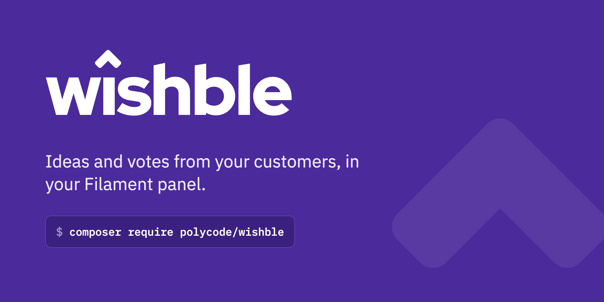

# Wishble support

Questions, bug reports and ideas for [Wishble](https://www.wishble.co.nz), the ideas board plugin for Filament panels. Wishble's code is
private, so this repository holds no code: it's where you reach us.

- **Something's broken:** [open an issue](https://github.com/polycode-nz/wishble-support/issues/new/choose).
  Include your Wishble, Filament, Laravel and PHP versions, and the steps that show it.
- **A question, or how to do something:** ask in
  [Discussions](https://github.com/polycode-nz/wishble-support/discussions). Someone else may have asked
  already.
- **An idea for Wishble:** post it in Discussions under Ideas.
- **A security problem:** email hello@polycode.co.nz. Please don't open a public issue for it.
- **Your licence, an invoice or a refund:** email hello@polycode.co.nz.

The [docs](https://www.wishble.co.nz/docs) cover installing and every setting, and the
[changelog](https://www.wishble.co.nz/changelog) says what each release changed.
